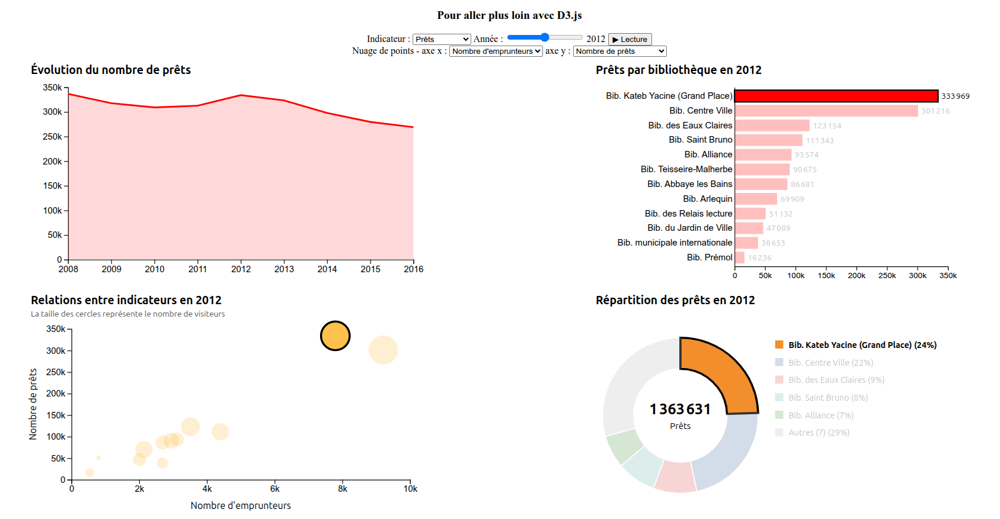

##  Graphiques animés et vues synchronisées avec D3.js

## Objectifs de la séance

Cette séance fait suite à la séance 8. Vous allez enrichir votre tableau de bord avec des graphiques réalisés avec D3.js, pour faire des choses que Plot ne permet pas (ou mal) :

- animer un graphique quand les données changent,
- sélectionner plusieurs éléments avec un rectangle (un *brush*),
- synchroniser tout cela avec la carte et les graphiques déjà présents dans la page.

Nous utilisons toujours les [statistiques des bibliothèques de Grenoble](https://data.metropolegrenoble.fr/visualisation/information/?id=statistiques-des-bibliotheques-de-grenoble).

## Point de départ

Vous repartez de votre page de la séance 8 : la carte, le menu `<select>` et les 4 courbes Plot.

Les nouveaux graphiques seront placés en dessous. Il y en a quatre :

1. une courbe avec une infobulle au survol,
2. un diagramme en barres animé, piloté par un curseur d'année,
3. un nuage de points dans lequel on sélectionne des bibliothèques avec un rectangle,
4. un diagramme en anneau.

Les deux premiers sont guidés. Pour les deux suivants, vous avez uniquement un cahier des charges.

Ajoutez ce bloc à la fin du `<body>`. Il contient les menus dont nous aurons besoin et un conteneur par graphique :

```html
<div id="d3-container">
  <h2>Pour aller plus loin avec D3.js</h2>
  <div>
    <label for="select-indicator">Indicateur : </label>
    <select id="select-indicator">
    </select>
    <label for="select-year">Année : </label>
    <input type="range" id="select-year" min="2008" max="2016" step="1" value="2016">
    <output id="output-year">2016</output>
    <button id="button-play">▶ Lecture</button>
  </div>
  <div>
    <label for="select-x">Nuage de points - axe x : </label>
    <select id="select-x">
    </select>
    <label for="select-y">axe y : </label>
    <select id="select-y">
    </select>
  </div>
  <!--
  Conteneurs pour les graphiques D3, adaptez les classes pour réutiliser le CSS existant
  ayant permis de créer votre grille de 4 graphiques Plot dans la séance 8.
  Vous pouvez aussi créer vos propres classes et styles dédiés pour cet exercice, mais
  c'est toujours mieux de réutiliser ce qui existe déjà !
  -->
  <div class="flex-container">
    <div class="graph" id="graph5"></div>
    <div class="graph" id="graph6"></div>
  </div>
  <div class="flex-container">
    <div class="graph" id="graph7"></div>
    <div class="graph" id="graph8"></div>
  </div>
</div>
```

Un petit rappel au passage. Dans votre code de la séance 8, la mise à jour de la page quand on sélectionne une bibliothèque est peut-être écrite à plusieurs endroits (clic sur un marqueur, changement du `<select>`). Si ce n'est pas déjà fait, c'est le moment de mutualiser : gardez ce que l'utilisateur a choisi dans quelques variables (bibliothèque, indicateur, année...) et écrivez une seule fonction qui met à jour tous les composants à partir de ces variables, appelée par tous vos écouteurs d'événements. Avec quatre graphiques de plus à tenir à jour, vous allez en avoir besoin.

## Créer une fois, mettre à jour ensuite

Avec Plot, nous avons remplacé les graphiques à chaque changement. Avec D3, on crée un graphique **une seule fois**, puis on le **met à jour** : c'est ce qui permet de l'animer, puisque D3 sait quels éléments existent déjà, lesquels apparaissent et lesquels disparaissent. Chaque graphique sera donc créé par une fonction qui retourne de quoi le mettre à jour :

```js
const lineChart = makeLineChart('graph5'); // une seule fois, au chargement de la page
lineChart.update(serie, indicator); // à chaque changement
```

## Les données

Regardez les propriétés d'une entité dans la console (`data.features[0].properties`). Le code de la bibliothèque est dans `CDL-Branch Code`, son nom dans `CDL-Libelle long Bib`, et les statistiques dans des propriétés de la forme `Prets_2008`, `Inscrits_2008`, `Emprunteurs_2008`, `Visiteurs_2008`, `Prets_2009`, etc.

Attention aux valeurs manquantes : elles sont codées tantôt par `null`, tantôt par `0`. Quatre bibliothèques n'ont aucune donnée, la bibliothèque d'Etude et du Patrimoine n'a que des visiteurs, et Abbaye les Bains a bien des prêts en 2010, mais 0 emprunteur. Un `0` n'est donc pas forcément un vrai zéro. Dans cette séance, `0` et `null` signifient tous les deux "pas de donnée" (c'est d'ailleurs ce que fait votre code de la séance 8 pour afficher "Pas de données"), et il faudra y penser dans tous les graphiques.

## Partie 1 - Une courbe avec D3

Dans `#graph5`, créez une courbe qui affiche l'évolution de l'indicateur choisi (les prêts par défaut) pour la bibliothèque sélectionnée, ou pour l'ensemble des bibliothèques si aucune n'est sélectionnée. Elle doit :

- avoir un titre, et la même couleur que le graphique Plot correspondant,
- avoir un axe en y qui commence à 0,
- présenter un trou quand une valeur est manquante, et afficher le message `Pas de données "Prêts" pour cette bibliothèque` quand il n'y a aucune donnée,
- s'animer quand on change de bibliothèque ou d'indicateur (menu `select-indicator`),
- afficher, au survol, l'année et la valeur du point le plus proche du curseur.

Un graphique D3 est un `<svg>` dans lequel on ajoute des éléments (`<path>`, `<rect>`, `<circle>`, `<text>`...) dont les positions sont calculées avec des **échelles**. Pour que le SVG s'adapte à la taille de son conteneur, on lui donne un `viewBox` et on met sa largeur et sa hauteur à 100%. Voici le point de départ :

```js
const makeLineChart = (id) => {
  const width = 600;
  const height = 340;
  const margin = { top: 45, right: 25, bottom: 40, left: 65 };

  const svg = d3.select(`#${id}`)
    .append('svg')
    .attr('viewBox', `0 0 ${width} ${height}`)
    .attr('width', '100%')
    .attr('height', '100%');

  // les échelles, les axes, le générateur de ligne...

  const update = (data, indicator) => {
    // ...
  };

  return { update };
};
```

Quelques pistes :

- En SVG, l'origine est en haut à gauche et l'axe y est orienté vers le bas : le `range` de votre échelle en y est donc "à l'envers".
- `d3.line()` transforme un tableau de points en attribut `d` d'un `<path>`, et sa méthode `defined` permet de laisser des trous dans la courbe.
- Pour animer un changement, passez par `.transition().duration(...)`. Comme on associe un seul tableau à un seul `<path>`, on utilise `datum()` plutôt que `data()`.
- Pour l'infobulle, il faut un rectangle transparent qui recouvre le graphique (attention : un élément sans remplissage ne reçoit pas les événements, voir `pointer-events`), `d3.pointer` pour récupérer la position du curseur, `x.invert` pour la convertir en année et `d3.bisector` pour retrouver la donnée la plus proche.

Si vous avez besoin de vous rafraîchir la mémoire sur D3, retournez voir le notebook [Faire des graphiques avec D3.js](https://observablehq.com/@sd-progwebdataviz/faire-des-graphiques-avec-d3-js).

Questions :

- Comparez l'axe en y de ce graphique avec celui du graphique Plot correspondant. Quel effet cela a-t-il sur la perception de l'évolution ?
- Que voit-on pour les emprunteurs de la bibliothèque Abbaye les Bains ? Est-ce que cela vous convient ?

## Partie 2 - Un diagramme en barres animé

Dans `#graph6`, affichez pour l'indicateur et l'année choisis une barre horizontale par bibliothèque, triées par valeur décroissante, avec le nom de la bibliothèque (abrégé si besoin) à gauche. Les bibliothèques sans donnée ne sont pas affichées. Ce graphique doit :

- s'animer quand on change d'année ou d'indicateur : les barres s'allongent, se déplacent et se réordonnent, les barres qui apparaissent ou disparaissent aussi,
- sélectionner la bibliothèque (carte, menu, courbes... tout doit être mis à jour) quand on clique sur une barre,
- mettre en évidence la bibliothèque sélectionnée, quelle que soit la manière dont elle a été sélectionnée.

Ajoutez aussi le pilotage de l'année : le curseur (`select-year`) et un bouton "Lecture" qui fait défiler les années de 2008 à 2016, par exemple une toutes les 1,5 secondes. Le bouton doit pouvoir mettre l'animation en pause, et elle doit s'arrêter après 2016. La valeur affichée à côté du curseur (`output-year`) doit toujours correspondre à l'année affichée.

Le concept central de D3 pour ce graphique est la **jointure de données**. Quand on écrit `selection.data(tableau).join(...)`, D3 compare les éléments déjà présents avec les données, et distingue ceux qu'il faut créer (*enter*), mettre à jour (*update*) et supprimer (*exit*). Pour qu'une barre reste associée à la même bibliothèque d'une année à l'autre, il faut lui fournir une **clé** :

```js
svg.selectAll('rect.bar')
  .data(rows, (d) => d.id) // le 2e argument est la clé
  .join((enter) => enter.append('rect')
    .attr('class', 'bar')
    // attributs initiaux des nouvelles barres...
  );                       // les barres en trop sont supprimées automatiquement
```

Quelques pistes :

- `d3.scaleBand` est fait pour positionner des catégories. Son domaine est la liste des identifiants, dans l'ordre d'affichage.
- Sur l'axe, on veut des noms et pas des identifiants : regardez la méthode `tickFormat` des axes.
- Pour que les axes et les barres s'animent ensemble, vous pouvez créer une transition partagée (`svg.transition()`) et la passer à `.transition(t)`.
- Écoutez l'événement `input` du curseur plutôt que `change`, qui n'est déclenché que lorsqu'on le relâche.

Questions :

- Que se passerait-il si vous n'aviez pas fourni de clé à `data()` ?
- Pourquoi n'y a-t-il pas le même nombre de barres pour les prêts et pour les emprunteurs en 2010 ?

## Partie 3 - Un nuage de points avec sélection par rectangle

Cette partie et la suivante n'ont pas de guide : à vous de choisir comment vous organisez votre code. Voici ce qui est attendu.

Dans `#graph7`, un nuage de points dans lequel chaque point est une bibliothèque, pour l'année choisie avec le curseur.

- La position des points est déterminée par deux variables choisies avec les menus `select-x` (par défaut le nombre d'emprunteurs) et `select-y` (par défaut le nombre de prêts). Au choix : prêts, inscrits, emprunteurs, visiteurs, et une variable calculée, le nombre de prêts par emprunteur.
- La taille des points représente le nombre de visiteurs, avec une aire proportionnelle à la valeur.
- Les bibliothèques pour lesquelles on ne peut pas placer un point ne sont pas affichées.
- Les points se déplacent (animation) quand l'année ou quand une variable change, et le nom de la bibliothèque s'affiche au survol d'un point.
- La bibliothèque sélectionnée (par n'importe quel moyen) est mise en évidence.
- L'utilisateur peut dessiner un rectangle de sélection. Les bibliothèques sélectionnées sont mises en évidence sur la carte (les autres sont atténuées) et dans le diagramme en barres, et le nuage de points atténue lui aussi les points qui ne sont pas dans le rectangle.
- Quand la position des points change (année ou variable), le rectangle n'a plus de sens : il doit disparaître et la page doit revenir à son état normal.

Pour vérifier que tout fonctionne :

- en 2016, avec les emprunteurs en x et les prêts en y, il y a 12 points,
- si vous sélectionnez les petites bibliothèques avec un rectangle, seuls leurs marqueurs restent bien visibles sur la carte, et les mêmes barres sont mises en évidence,
- déplacer ou redimensionner le rectangle doit rester fluide (les graphiques Plot n'ont aucune raison d'être redessinés à chaque mouvement de la souris),
- si vous changez d'année avec un rectangle tracé, il disparaît et tous les marqueurs redeviennent normaux,
- si vous sélectionnez une bibliothèque dans le menu, son point est mis en évidence, et si vous revenez à "Toutes les bibliothèques", il ne l'est plus.

Pour démarrer, regardez la [documentation de `d3.brush`](https://d3js.org/d3-brush) et l'exemple [Brushable scatterplot](https://observablehq.com/@d3/brushable-scatterplot).

## Partie 4 - Un diagramme en anneau

Dans `#graph8`, représentez la part de chaque bibliothèque dans l'indicateur et l'année choisis.

- Avec une dizaine de bibliothèques, un diagramme circulaire est difficile à lire : on affiche les 5 premières et on regroupe toutes les autres dans une part "Autres". Si la bibliothèque sélectionnée n'est pas parmi les 5 premières, elle doit tout de même avoir sa propre part.
- Une légende permet d'identifier chaque part et indique son pourcentage, et le total est affiché au centre de l'anneau.
- Un clic sur une part sélectionne la bibliothèque correspondante, sauf pour "Autres".
- Quand l'année ou l'indicateur change, les parts s'animent (elles ne "sautent" pas d'un état à l'autre).
- La bibliothèque sélectionnée et celles sélectionnées avec le rectangle du nuage de points sont mises en évidence. La part "Autres" est mise en évidence si elle contient au moins l'une d'entre elles.

Pour vérifier :

- en 2016, pour les prêts, il y a 6 parts,
- si vous sélectionnez la bibliothèque Prémol, elle apparaît dans une 7ème part,
- un clic sur "Autres" ne fait rien,
- si vous sélectionnez les petites bibliothèques avec le rectangle, la part "Autres" reste bien visible alors que les autres s'estompent.

::: {.callout-tip}
Pour dessiner un anneau, regardez `d3.pie` et `d3.arc`. L'animation est plus délicate : on ne peut pas animer directement l'attribut `d`, il faut animer les angles avec `attrTween` et `d3.interpolate`.
:::

Question : lequel du diagramme en anneau ou du diagramme en barres permet le mieux de comparer les bibliothèques ? Pourquoi ?

## Pour aller plus loin

### Deux onglets

Avec tous ces graphiques, votre page est devenue assez longue et il faut descendre pour voir les graphiques D3. Réorganisez-la en deux onglets :

- un onglet "Carte", avec la vue de la séance 8 (la carte et les 4 graphiques Plot),
- un onglet "Graphiques D3", avec les 4 graphiques réalisés pendant cette séance et leurs menus (indicateur, année, axes du nuage de points).

Le menu de sélection d'une bibliothèque est commun aux deux vues : placez-le au-dessus des onglets, pour qu'il reste visible quel que soit l'onglet affiché. Vous n'avez ainsi qu'un seul menu à garder synchronisé avec le reste de la page.

Tout doit rester synchronisé d'un onglet à l'autre. Pour vérifier :

- cliquez sur une barre du diagramme en barres, puis passez sur l'onglet "Carte" : le marqueur de la bibliothèque est vert et les graphiques Plot sont à jour,
- dessinez un rectangle dans le nuage de points, puis passez sur l'onglet "Carte" : les marqueurs des bibliothèques non sélectionnées sont atténués,
- cliquez sur un marqueur, puis revenez sur l'onglet "Graphiques D3" : la bibliothèque est mise en évidence dans tous les graphiques, sans que vous ayez eu à y toucher.

Quelques pistes :

- Pas besoin de bibliothèque : deux boutons et l'attribut `hidden` (ou une classe CSS) suffisent. Attention, `hidden` n'a plus d'effet si votre CSS donne une valeur à la propriété `display` de l'élément : placez-le plutôt sur un élément qui englobe ce que vous voulez cacher.
- Un graphique D3 ou Plot créé dans un onglet masqué se dessine sans problème. Leaflet est plus capricieux : si la carte s'affiche mal après un changement d'onglet (tuiles grises, carte décalée), regardez la méthode `invalidateSize()`.
- Si votre code de mise à jour est mutualisé, il n'y a rien d'autre à changer : cacher un onglet ne modifie pas l'état de la page.

Pour les plus rapides : mémorisez l'onglet actif dans l'URL (avec `location.hash`) pour le retrouver après un rechargement de la page.

### Et après ?

Si vous avez terminé, vous pouvez essayer :

- un graphique radar du profil d'une bibliothèque, comparé à la moyenne des bibliothèques (`d3.lineRadial`),
- un treemap des prêts par bibliothèque (`d3.hierarchy` et `d3.treemap`),
- des cercles proportionnels dessinés avec D3 directement sur la carte Leaflet (`L.svg()` et `map.latLngToLayerPoint`),
- un bump chart du rang des bibliothèques au fil des années.

### Voir aussi

- la [documentation de D3.js](https://d3js.org/),
- l'exemple [Bar chart race](https://observablehq.com/@d3/bar-chart-race).

## Pour récapituler



À la fin de la séance, votre page doit contenir :

- la carte, le menu déroulant et les 4 graphiques Plot de la séance 8, toujours synchronisés,
- la courbe D3 avec son infobulle (partie 1),
- le diagramme en barres animé avec le curseur d'année (partie 2),
- le nuage de points avec sélection par rectangle, dont la sélection est répercutée sur la carte (partie 3),
- le diagramme en anneau avec sa légende et le total au centre (partie 4).